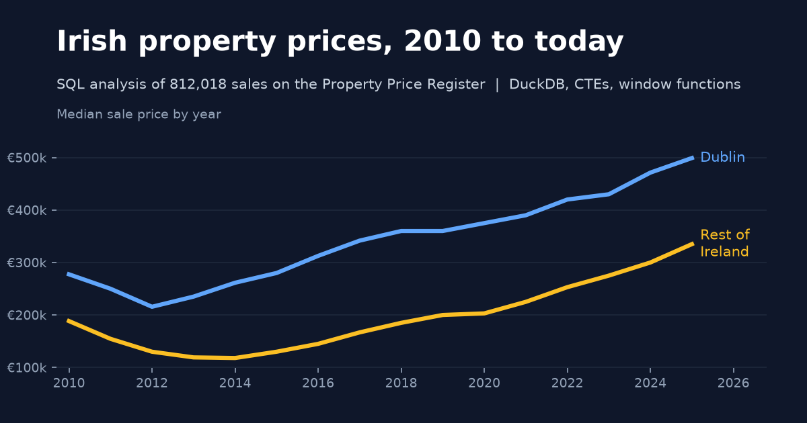
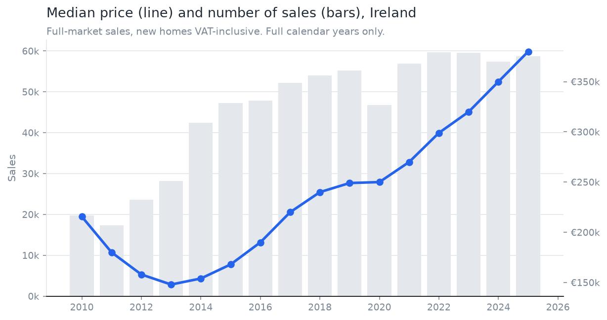
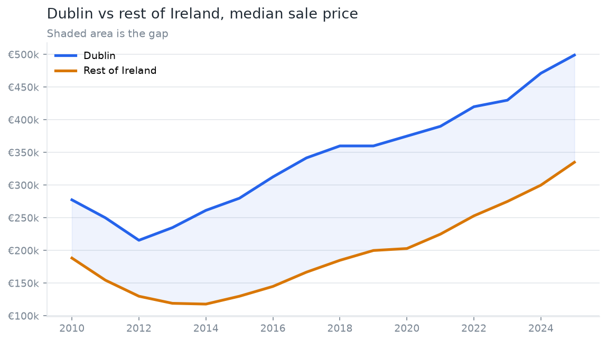
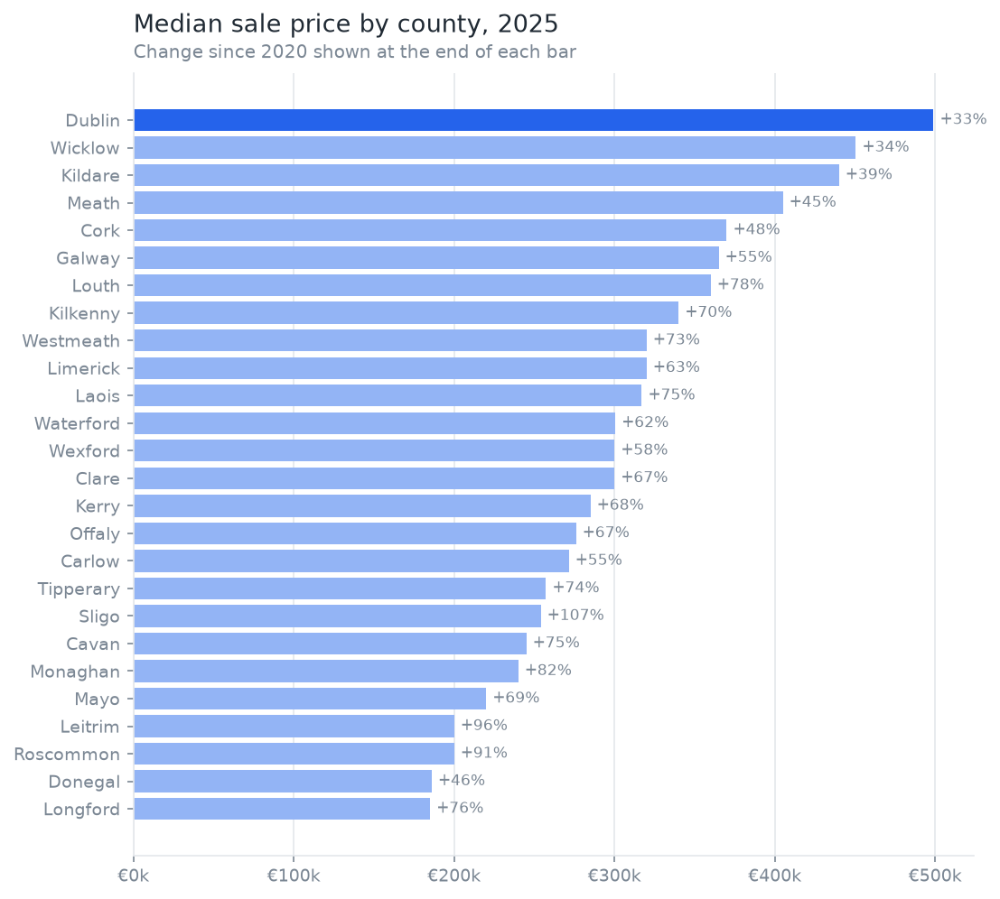
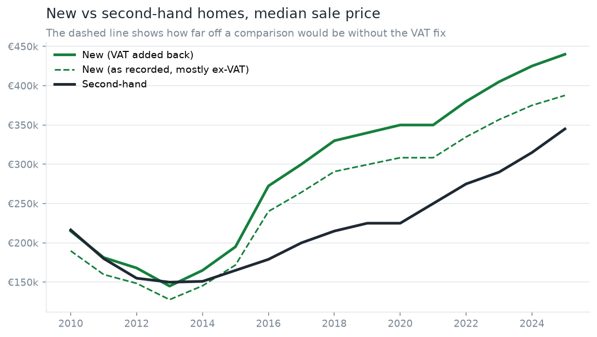
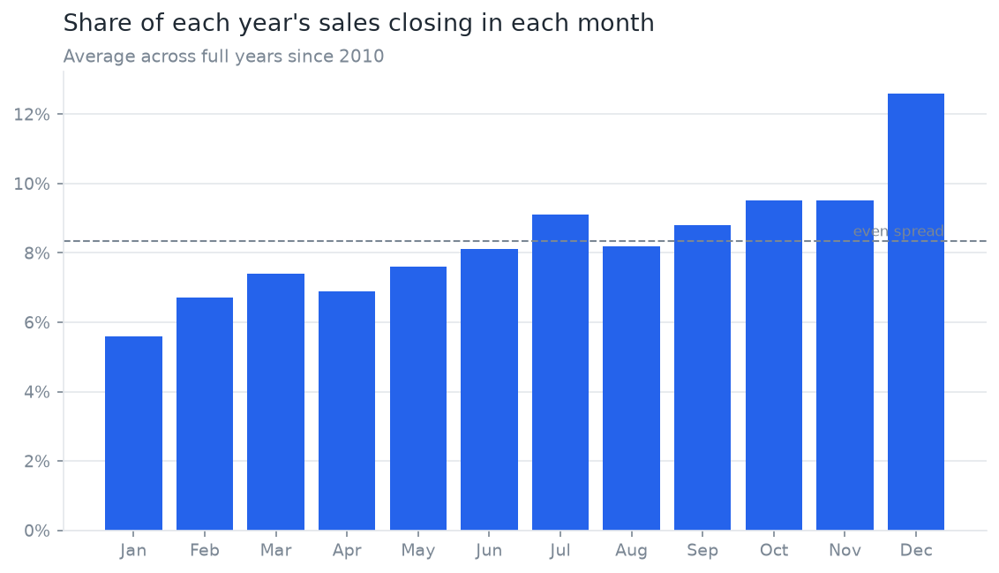
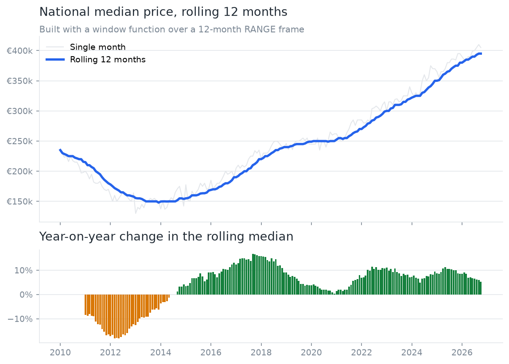

# Irish Property Prices in SQL

**Question: how have Irish house prices and sales changed since 2010, and where in the country have they moved most?**

An SQL analysis of every residential sale on Ireland's Property Price Register, January 2010 to October 2026 (812,018 sales after cleaning). All the analysis is SQL run in DuckDB. Python only downloads the file, runs the SQL in order and draws the charts.



## Key findings

Prices are medians of full-market sales, with VAT added back on new homes (see [Walkthrough](#walkthrough)). Every number below comes from the CSV files in `results/`.

- **The national median sale price was €380,000 in 2025, up from a low of €148,000 in 2013** (+157%). It is now well above the 2010 level of €215,650. The rolling 12-month median reached €395,000 by October 2026, but growth is slowing: +5.3% on a year earlier, down from a peak of 11.3% in May 2025.
- **Dublin is still the dearest county at €498,999, but the rest of the country is catching up.** In 2014 a Dublin home cost 2.22 times the median elsewhere. By 2025 that had fallen to 1.49 times (€335,000 outside Dublin). The gap in euro has stayed at about €150,000 to €175,000 since 2016.
- **The fastest risers since 2020 are smaller, cheaper counties.** Sligo's median more than doubled (+107%, €122,500 to €254,000), with Leitrim (+96%) and Roscommon (+91%) close behind. Dublin rose least (+33%). Longford (€185,000) and Donegal (€186,000) are the cheapest counties.
- **New homes are a growing slice of the market and their price premium is shrinking.** New homes made up 22.9% of sales in 2025, up from 12.3% in 2013. Their premium over second-hand homes fell from 55.6% in 2020 to 27.5% in 2025 (€440,000 against €345,000). Without adding VAT back, the 2025 new-home median would read €387,665, which understates it by about €52,000.
- **December is by far the busiest month for completed sales.** On average 12.6% of a year's sales close in December, compared with 5.6% in January, and December was the busiest month in 15 of the 16 full years.
- **Medians matter here.** The 2025 mean price was €434,741, about €55,000 above the median, because a small number of very dear homes pull the average up.

## Charts

| | |
|---|---|
|  |  |
|  |  |
|  |  |

## How to run in 3 commands

```bash
python -m venv .venv && .venv/Scripts/pip install -r requirements.txt   # macOS/Linux: .venv/bin/pip
.venv/Scripts/python scripts/download.py                               # about 19 MB zip, 111 MB CSV
.venv/Scripts/python scripts/run_all.py                                # runs sql/01 to sql/08, writes results/ and charts/
```

Run the tests with `.venv/Scripts/python -m pytest`. They use the 1,000-row sample in `data/sample/`, so they work without the download. The whole pipeline takes about 10 seconds on a laptop.

## Project layout

```
sql/                 the analysis, one numbered file per question
scripts/download.py  fetches the register from propertypriceregister.ie
scripts/run_all.py   runs every SQL file in order, saves results/*.csv and charts/*.png
scripts/make_sample.py  writes the 1,000-row test sample
data/sample/         1,000 raw rows, committed for the tests
data/raw/            the full download (not committed)
results/             one CSV per SQL file
charts/              PNG charts, including the portfolio tile
tests/               pytest checks on the cleaning logic
```

## Walkthrough

### 01_load_and_clean.sql

Loads the raw CSV and builds three things: `sales` (every valid sale), `market_sales` (the rows used for price analysis) and `cleaning_log`.

The raw file needs care:

- It is encoded in **Windows-1252**, not UTF-8. The euro sign is a single byte (0x80) in that encoding, so reading it as UTF-8 fails. DuckDB reads it directly with `encoding = 'windows-1252'`.
- **Prices are text** such as `€343,000.00`. `regexp_replace(price_text, '[^0-9.]', '', 'g')` deletes every character that is not a digit or a full stop, leaving `343000.00`, which is then cast to a number.
- **Dates are DD/MM/YYYY.** `try_strptime(sale_date_text, '%d/%m/%Y')` reads them. The `try_` version returns NULL for a bad date instead of crashing the query, so we can count and remove the bad rows.
- **Flags are Yes/No text.** `not_full_market_price_text = 'Yes'` turns them into TRUE/FALSE.
- **Descriptions** come in English and Irish ("Teach/Árasán Cónaithe Nua" means new dwelling). A `CASE` statement maps both to `is_new_dwelling`.
- **VAT**: new homes are mostly recorded excluding VAT. `price_incl_vat` adds 13.5% (the residential VAT rate) only where the VAT-exclusive flag is Yes, so new and second-hand homes are compared on what the buyer paid.

Cleaning rules and how many rows each one removed (from `results/01_load_and_clean.csv`):

| Step | Rule | Rows removed | Rows left |
|---|---|---:|---:|
| 0 | Rows in the raw file | | 813,106 |
| 1 | Date or price could not be parsed, or price not above zero | 0 | 813,106 |
| 2 | Exact duplicate rows (same date, address, county, price and flags) | 1,088 | 812,018 |
| 3 | Marked "not full market price" (kept in `sales`, left out of price analysis) | 41,190 | 770,828 |
| 4 | Price under €10,000 or over €10m (kept in `sales`, left out of price analysis) | 1,284 | 769,544 |

Steps 3 and 4 do not delete anything. They define the `market_sales` view. Non-market sales are things like transfers between family members, where the price does not reflect the market. Prices over €10m are mostly bulk deals where a block of apartments is recorded with one combined price.

### 02_overview.sql

Sales count, median and mean price per year. A CTE does the `GROUP BY`, then `LAG()` compares each year's median with the year before.

**Why medians and not means?** The median is the middle sale when all sales are sorted by price. House prices are skewed: most homes sell in a fairly narrow band, but a few sell for millions. Those few drag the mean up, while the median barely moves. In 2025 the mean was €434,741 and the median €380,000. The CSO and Daft also report medians for this reason.

### 03_by_county.sql

Median price and sales by county for the latest full year, compared with five years earlier. "Latest full year" is worked out in SQL as the most recent year that has December sales, so the answer stays right as new data arrives. The query joins a county-by-year CTE to itself: once for the latest year (`cur`) and once for five years earlier (`prev`). `RANK()` gives each county its price rank, and counties with the same median share a rank.

### 04_dublin_vs_rest.sql

A `CASE` labels every sale as Dublin or Rest of Ireland. Medians are worked out per region per year, then **conditional aggregation** (`max(CASE WHEN region = 'Dublin' THEN median_price END)`) turns the two region rows into two columns, so the gap and the ratio are simple subtractions and divisions.

### 05_new_vs_second_hand.sql

Compares new and second-hand homes per year. `FILTER (WHERE is_new_dwelling)` applies an aggregate to only some rows in the group, for example `median(price_incl_vat) FILTER (WHERE is_new_dwelling)`. It shows the new-home median both as recorded and with VAT added back, to make the size of the VAT effect visible.

### 06_seasonality.sql

Counts sales per calendar month for each full year. `sum(sales) OVER (PARTITION BY sale_year)` gives each row its year's total, so every month becomes a share of its own year. That stops busy years like 2022 from swamping quiet ones like 2011. `RANK() OVER (PARTITION BY sale_year ORDER BY sales DESC)` finds the busiest month of each year. Note the register records when a sale **closed**, not when the offer was agreed, which helps explain the December rush as buyers and sellers aim to finish before year end.

### 07_window_functions.sql

The rolling 12-month median and its year-on-year change, built in four CTE steps:

1. `median(price_incl_vat) OVER (ORDER BY sale_month_start RANGE BETWEEN INTERVAL 11 MONTH PRECEDING AND CURRENT ROW)` gives each sale the median of all sales in its month and the 11 months before. `RANGE` works on the date values, not on row counts, which matters because months have different numbers of sales.
2. Collapse to one row per month.
3. Count and median for each month on its own.
4. `LAG(rolling_median, 12)` fetches the value 12 months earlier for the year-on-year change, and `sum(sales) OVER (ORDER BY month ROWS BETWEEN UNBOUNDED PRECEDING AND CURRENT ROW)` gives a running total.

This takes the median of all sales in the window, not a median of 12 monthly medians, which would give quiet months as much weight as busy ones.

### 08_data_quality.sql

Fifteen checks stacked with `UNION ALL` into one report. Highlights:

- No missing addresses, counties, dates or prices.
- Eircodes are missing for 68.6% of all rows. They only appear in volume from 2021, and 24.2% of sales from 2022 on still have none, so Eircode cannot be used for long-run analysis.
- Property size is filled in for only 6.5% of rows.
- 5.1% of sales are flagged as not full market price.
- 1.7% of market sales sit above Q3 + 3 x IQR. We keep them, because a €1.5m house in Dublin 4 is real, and the median handles them.
- 793 address and date pairs appear with more than one price, and 287 addresses name a different county ("Co. X") from the county column.
- 1.6% of new homes are recorded VAT inclusive, and no second-hand homes are flagged VAT exclusive, which is what we would expect.

### 09_county_year.sql

Every county in every year: sales, median price, the change on the year before (`LAG` partitioned by county) and that year's price rank (`RANK` partitioned by year). 26 counties × 17 years = 442 rows. This table drives the interactive dashboard at https://smadhu6364-beep.github.io/dashboard/.

### SQL ideas used, in plain language

- **CTE (`WITH name AS (...)`)**: a named, temporary result. It lets you build a query in readable steps instead of nesting subqueries inside each other.
- **Window function (`... OVER (...)`)**: a calculation that looks at other rows related to the current one (the previous year, the last 12 months, the same year) without collapsing the rows the way `GROUP BY` does. Used for `LAG`, `RANK`, running totals, shares of a total and rolling medians.
- **`PARTITION BY`**: restarts the window for each group, such as each year.
- **`CASE WHEN`**: if/then logic inside a query, used to label regions and property types and to pivot rows into columns.
- **Date functions**: `try_strptime` to parse text dates, `year()`, `month()`, `date_trunc('month', ...)` to group by month, and `INTERVAL` for date ranges.
- **Aggregation**: `count`, `median`, `avg`, `quantile_cont` with `GROUP BY`, plus `FILTER (WHERE ...)` to aggregate a subset.
- **Filtering non-market sales**: done once in the `market_sales` view, so every price query uses the same rules and nobody forgets the filter.

## Data source and licence

- **Source**: Residential Property Price Register, published by the Property Services Regulatory Authority (PSRA), https://www.propertypriceregister.ie. Downloaded on 26 October 2026; the register said it was last updated on 21 October 2026. The latest sale in the file is dated 16 October 2026.
- **Licence**: the PSRA makes the register available for re-use under the Re-use of Public Sector Information rules (see https://www.psr.ie/re-use-of-public-sector-information/), and its register data on data.gov.ie is published under Creative Commons Attribution 4.0 (CC BY 4.0). This project credits the PSRA as the source. The register's own disclaimer says the information is a guide only and the State accepts no responsibility for errors or omissions.
- The raw file is not committed. `scripts/download.py` fetches it, and a 1,000-row sample is committed for the tests.

## Limitations

- **Sale price, not asking price.** The register records the price declared for stamp duty. That is what was paid, which is good, but it says nothing about asking prices or bidding wars.
- **VAT.** New homes are usually recorded without VAT. We add 13.5% back when the flag says so, which assumes the standard residential rate applied to every such sale.
- **Coverage and timing.** The register includes sales declared to Revenue for stamp duty from 2010 on. Sales are dated when they closed, not when agreed, and late filings mean the most recent months can be revised upwards. 2026 is a part year, so the README uses 2025 as the latest full year.
- **No size or property type.** There is no floor area (size bands exist for only 6.5% of rows), no bedrooms and no house/apartment split, so a rising median can partly reflect a change in the mix of homes sold as well as real price growth. The CSO's Residential Property Price Index adjusts for mix and is the better source for a like-for-like price index.
- **Bulk and odd sales.** Some multi-unit deals are recorded as one price per unit or one combined price. The €10,000 to €10m filter and the not-full-market flag remove most of these, but not all.
- **Address quality.** Addresses are free text typed by solicitors, so spelling varies and a small number disagree with the county column (287 rows).
